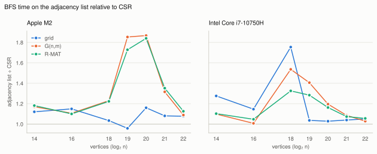

# elemgraph

Elementary graph algorithms in C++20, and experiments on what makes them fast in practice.

elemgraph is a header-only library of graph representations and elementary algorithms: BFS,
DFS, connected components, bridges and cut vertices, and certifying tests for 2-edge- and
2-vertex-connectivity. BFS, connected components, and bridges and cut vertices each have two
implementations. All algorithms are checked against brute-force references and benchmarked.

Version 0.2 investigates three questions. The first two were measured on two machines, an Apple M2
and an Intel x86-64 laptop:

- **Q4.** How does the chain decomposition of [Schmidt 2013] compare in practice with the classic
  lowpoint algorithm [Hopcroft & Tarjan 1973; Tarjan 1974] for finding bridges and cut vertices?
- **Q1.** How much faster is BFS with a contiguous CSR layout than with a vector-of-vectors
  adjacency list, and how does the difference depend on the graph class?

The third question is new in version 0.2. It comes with certifying tests for 2-edge- and
2-vertex-connectivity, and so far it has been measured on the M2 only:

- **Q6.** What does certification cost in practice? How expensive are producing and checking a
  certificate compared with the plain test?

elemgraph is developed by Yunze Han with Claude (Anthropic) as an AI coding assistant. Claude
generated much of the code, tests and documentation. Yunze Han reviewed and merged all changes.

## Results

Benchmarks were run on two machines:

- An Apple M2 running macOS, with Clang 21 and libc++.
- An Intel Core i7-10750H laptop running Linux, with GCC 16 and libstdc++. Runs on this machine
  are pinned to one core at a fixed 2.6 GHz, with hardware counters recorded.

The CPU and the compiler both differ between the two machines, so a difference between them can
come from either. Each reported value is the median of 10 repetitions on synthetic graphs with
2^14 to 2^22 vertices: 2D grids, uniform random graphs G(n,m) with average degree 8, and R-MAT
graphs with power-law degree distributions.

### Q4: chain decomposition vs. lowpoint

<picture>
  <source media="(prefers-color-scheme: dark)" srcset="bench/results/q4-dark.svg">
  
</picture>

Both algorithms start with the same DFS on the same graph and produce the same output. The
left-hand charts therefore compare only the work performed after the search.

- **The faster algorithm depends on the machine.** On the M2, the lowpoint algorithm is faster in
  20 of 24 cases, by 1.2–1.9× when the graph fits in cache. On the x86 laptop, the chain
  decomposition is faster in 10 of 24 cases:
  - by 2–6 % on grids;
  - by 3–6 % on G(n,m) graphs with 2^18 to 2^20 vertices.

  On R-MAT graphs, the lowpoint algorithm is 1.1–1.35× faster on the x86 laptop.
- **The hardware counters refute an earlier guess.** The guess was that the chain decomposition
  executes more instructions. On the x86 laptop, however, it executes 11–13 % *fewer*
  instructions than the lowpoint algorithm, on every graph class and at every size. On R-MAT, it
  incurs about 2.5 more branch mispredictions per vertex (4.3–4.8, compared with 1.5–2.3). At
  15–20 cycles each, a typical cost on this CPU, they explain about half of the gap or more when
  the graph fits in cache.
- **Including the DFS makes the difference small.** From 2^20 vertices on, the whole computation
  with the chain decomposition takes 0.98–1.09× as long as with the lowpoint algorithm, on both
  machines.

### Q1: CSR vs. adjacency list for BFS

<picture>
  <source media="(prefers-color-scheme: dark)" srcset="bench/results/q1-dark.svg">
  
</picture>

- **CSR is faster in almost every case.** Apart from the peaks described below, BFS on the
  adjacency list takes 1–35 % longer. The one exception is the grid with 2^19 vertices on the M2,
  where the adjacency list is 4 % faster.
- **The largest speedup occurs at different sizes on the two machines.**
  - On the M2, CSR is 1.7–1.9× faster on G(n,m) and R-MAT graphs with 2^19 and 2^20 vertices.
  - On the x86 laptop, the largest speedup occurs at 2^18 vertices: 1.33–1.75× across all three
    graph classes. At 2^19 vertices, G(n,m) and R-MAT still show 1.28–1.41×.
- **The counters point to memory.** On the x86 laptop, both representations execute the same
  number of instructions and incur the same number of branch mispredictions. The adjacency list's
  longer running time comes with more L3 cache misses: at 2^18 vertices, 0.9–6.8 per vertex,
  compared with 0.02–1.3 for CSR.
- **A simple size estimate predicted the wrong peak.** On the M2, the largest speedup occurs where
  CSR's randomly accessed data fits in the 16 MB L2 cache but the adjacency list's does not: 12
  bytes per vertex for CSR, compared with 32 for the adjacency list. The same estimate predicted a
  peak at 2^19 vertices on the x86 laptop, which has a 12 MB L3 cache. The measured peak is at
  2^18. Counting all the data that BFS reads predicts the x86 peak correctly, but not the M2's.

The full tables, the hardware counters, the variation across repetitions and runs, and further
observations are in [`bench/results/m2/2026-11-11.md`](bench/results/m2/2026-11-11.md) and
[`bench/results/x86-laptop/2026-11-11.md`](bench/results/x86-laptop/2026-11-11.md).

### Q6: the cost of certification

<picture>
  <source media="(prefers-color-scheme: dark)" srcset="bench/results/q6-dark.svg">
  
</picture>

These results are from the M2 only. A certifying test answers yes with an ear decomposition taken
from the chains, and no with a small vertex set
([`docs/certifying-connectivity.md`](docs/certifying-connectivity.md)). The plain test is the
chain decomposition without keeping the chains. Grids and G(n,m) plus a Hamiltonian cycle are
2-vertex-connected; G(n,m) is not. The figure shows 2-vertex-connectivity.

- **Producing a certificate costs 1.22–1.55× the plain test, DFS included.** On grids the ratio
  stays at 1.22–1.32 at every size. On the random graphs it peaks at about 1.5 with 2^19 vertices.
  Certifying 2-vertex-connectivity costs 0–8 % more than 2-edge-connectivity after the search.
- **Checking a "yes" certificate is faster than the plain test.** The checker uses only the graph
  and the certificate, with no DFS. It takes 0.69–0.75× the time of the plain test with DFS on
  grids, and 0.29–0.63× on G(n,m) plus a cycle. There, from 2^19 vertices on, it is faster than
  the DFS alone.
- **The extra cost of certifying has two parts of about equal size, measured once outside the
  benchmark suite.** The chains are stored: 369 MB for G(n,m) plus a cycle with 2^22 vertices,
  more than the CSR graph. Also, the id of each tree edge on a chain is found by scanning a list.
  Both parts can be made cheaper.
- **The "no" certificates of this run are trivial.** From 2^14 vertices on, the G(n,m) graphs
  have isolated vertices. The certificate is then a single vertex, checked in under 50 µs.
  Checking a large "no" certificate has not been measured yet.

The tables and the details are in
[`bench/results/m2/2026-11-22.md`](bench/results/m2/2026-11-22.md).

### Open questions

- Why does the Q1 speedup peak at 2^19–2^20 vertices on the M2 but at 2^18 on the x86 laptop? No
  single estimate of bytes per vertex explains both.
- On the x86 laptop, BFS on a grid becomes 5× slower per vertex from 2^19 vertices on, while DFS on
  the same grid does not. One possible explanation is TLB misses: on a grid, the BFS frontier is a
  diagonal, and from 2^19 vertices on, each of its vertices lies on a different 4 KB page.
- Which branches cause the additional mispredictions of the chain decomposition on R-MAT? And how
  much of the Q4 difference between the machines comes from the compiler rather than the CPU?
- DFS executes 3–3.5× as many instructions per vertex as BFS. On G(n,m) and R-MAT graphs, it
  takes 1.8–3.5× as long.
- On the M2, BFS on the grid with 2^19 vertices is faster on the adjacency list than on CSR.
- Why does checking an ear decomposition overtake the DFS on large random graphs? One guess is
  that its random accesses do not depend on each other, while those of the DFS do.

## Included in v0.2

| Part | Implementations | File |
|------|-----------------|------|
| Representations | `csr_graph` (built by counting sort), `adjacency_list` (vector of vectors), both constructed from an `edge_list` | [`include/elemgraph/`](include/elemgraph/) |
| BFS | flat-array queue vs. `std::queue` | [`algorithms/bfs.hpp`](include/elemgraph/algorithms/bfs.hpp) |
| DFS | iterative, explicit stack; preorder, DFS numbers and parents | [`algorithms/dfs.hpp`](include/elemgraph/algorithms/dfs.hpp) |
| Connected components | BFS vs. union-find | [`algorithms/components.hpp`](include/elemgraph/algorithms/components.hpp) |
| Bridges, cut vertices | lowpoint vs. chain decomposition (which can also return the chains) | [`algorithms/connectivity.hpp`](include/elemgraph/algorithms/connectivity.hpp) |
| Certifying 2-edge- and 2-vertex-connectivity | yes: an ear decomposition (open for 2-vertex) taken from the chains; no: a vertex set that at most one edge leaves, or that one vertex separates from the rest; checkers in O(n + m) | [`algorithms/certifying.hpp`](include/elemgraph/algorithms/certifying.hpp) |

The algorithms are templates over the concepts in
[`concepts.hpp`](include/elemgraph/concepts.hpp), so the same code works with both
representations. Graphs may have parallel edges, multiple components and vertices of any degree;
self-loops are discarded. [Schmidt 2013] proves the characterizations behind the chain
decomposition for simple connected graphs.
[`docs/chain-decomposition.md`](docs/chain-decomposition.md) proves the rules that elemgraph uses
for this more general input.
[`docs/certifying-connectivity.md`](docs/certifying-connectivity.md) proves that every certificate
the checkers accept proves its answer, and that the certifying tests always find one.

**Correctness.**
- Every algorithm is tested against a brute-force reference that applies the definitions
  directly, on thousands of random multigraphs with parallel edges, self-loops and multiple
  components.
- The two implementations of each problem are also compared with each other.
- Every certificate is checked. The checkers must also reject certificates that were made wrong
  on purpose.
- On Linux, CI builds and tests with GCC, with Clang, and with GCC under AddressSanitizer and
  UndefinedBehaviorSanitizer; on macOS, with Clang. It also runs every benchmark once on small
  graphs.

## Using it

```cpp
#include <elemgraph/algorithms/certifying.hpp>
#include <elemgraph/algorithms/connectivity.hpp>
#include <elemgraph/csr_graph.hpp>
#include <iostream>

int main() {
    // Two triangles that share vertex 2, and an edge hanging off vertex 4.
    elemgraph::edge_list list(6);
    list.add_edge(0, 1);
    list.add_edge(1, 2);
    list.add_edge(2, 0);
    list.add_edge(2, 3);
    list.add_edge(3, 4);
    list.add_edge(4, 2);
    list.add_edge(4, 5);
    const elemgraph::csr_graph g(list);

    const elemgraph::connectivity_result result = elemgraph::chain_connectivity(g);
    for (const elemgraph::edge_id e : result.bridges) {
        std::cout << "bridge " << list.edges()[e] << '\n';  // bridge 4-5
    }
    for (const elemgraph::vertex v : result.cut_vertices) {
        std::cout << "cut vertex " << v << '\n';  // cut vertex 2, cut vertex 4
    }

    // A certifying test also returns a certificate for its answer: here, that vertex 4
    // separates vertex 5 from the rest. The checker verifies it using only the graph.
    const auto certificate = elemgraph::certify_two_vertex_connectivity(g);
    const bool valid = elemgraph::check_two_vertex_connectivity(g, certificate);
    std::cout << "separator " << certificate.separator << ", valid " << valid << '\n';
    // separator 4, valid 1
}
```

The library requires only a C++20 compiler. Add `include/` to your include path, or add the
repository to a CMake project with `add_subdirectory(elemgraph)` and link against
`elemgraph::elemgraph`.

## Building, testing and benchmarking

All builds and benchmarks run in a Nix development shell, which provides fixed versions of the
compilers, CMake, GoogleTest and Google Benchmark:

```sh
nix develop                      # enter the dev shell
cmake --workflow --preset dev    # build and run the tests (also: release, sanitize)
nix flake check                  # run the CI checks: GCC, Clang and sanitizer builds on Linux
bench/run.sh m2                  # run all benchmarks, writing to bench/results/m2/<date>.json
nix develop .#plot -c python3 bench/plot.py bench/results/m2/<date>.json --tables
nix develop .#plot -c python3 bench/plot.py --out bench/results \
    bench/results/m2/<date>.json bench/results/x86-laptop/<date>.json   # the figures above
```

Without Nix, you need CMake 3.25 or newer, a C++20 compiler, GoogleTest and Google Benchmark.

`bench/run.sh` records the commit and the machine's settings alongside the results. On Linux, it
also pins the process to one core, checks the CPU governor and turbo settings, and collects
hardware counters for each benchmark. A full run takes about 25 minutes on the M2.

**Platform limitations.** On macOS, threads cannot be pinned to a specific core and the CPU clock
cannot be fixed. Benchmarks run at the highest QoS class to keep them on the performance cores.
Timing variation is reported with each result. CI runs on virtual machines, so its timings are not
reported.

## Plans

| Version | Topic |
|---------|-------|
| v0.3 | Certifying 3-edge-connectivity [Mehlhorn, Neumann, Schmidt 2017], building on the chain decomposition |
| v0.4 | Vertex and edge index types as template parameters, and the impact of 32- or 64-bit indices (Q2). Memory layout (Q3). The open questions above: TLB counters, a Clang build on Linux, profiling the chain decomposition, a faster DFS, and the two parts of the cost of certification. |
| later | Vertex reordering (Q5), weighted graphs and Dijkstra, parallel BFS and connected components |

The design, the research questions and the benchmark method are described in
[`docs/DESIGN.md`](docs/DESIGN.md). Changes are listed in [`CHANGELOG.md`](CHANGELOG.md).

## References

- J. M. Schmidt. *A simple test on 2-vertex- and 2-edge-connectivity.* Information Processing
  Letters 113(7):241–244, 2013.
- J. Hopcroft, R. Tarjan. *Algorithm 447: Efficient algorithms for graph manipulation.*
  Communications of the ACM 16(6), 1973.
- R. E. Tarjan. *A note on finding the bridges of a graph.* Information Processing Letters 2(6),
  1974.
- K. Mehlhorn, A. Neumann, J. M. Schmidt. *Certifying 3-edge-connectivity.* Algorithmica
  77:309–335, 2017.

## License

MIT. See [`LICENSE`](LICENSE).
