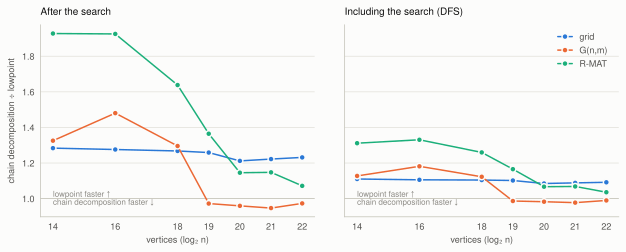
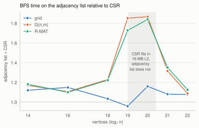

# elemgraph

Elementary graph algorithms in C++20, and experiments on what makes them fast in practice.

elemgraph is a header-only library of graph representations and elementary algorithms: BFS,
DFS, connected components, bridges and cut vertices. Each algorithm is implemented in two ways,
checked against a brute-force reference, and measured. Version 0.1 answers two questions on an
Apple M2:

- **Q4.** How does the chain decomposition of [Schmidt 2013] compare in practice with the classic
  lowpoint algorithm [Hopcroft & Tarjan 1973; Tarjan 1974] for bridges and cut vertices?
- **Q1.** How much does a contiguous CSR layout gain over a vector-of-vectors adjacency list for
  BFS, and how does that depend on the graph class?

elemgraph is developed by Yunze Han together with an AI coding assistant (Claude, by Anthropic).
The assistant wrote much of the code, tests and documentation. Every change was reviewed and
merged by Yunze Han.

## Results

All numbers come from one machine, an Apple M2 (details below). Each value is the median of 10
repetitions on synthetic graphs with 2^14 to 2^22 vertices: 2D grids, uniform random graphs
G(n,m) with average degree 8, and R-MAT graphs with power-law degrees.

### Q4: chain decomposition vs. lowpoint

<picture>
  <source media="(prefers-color-scheme: dark)" srcset="bench/results/m2/2026-11-11-q4-dark.svg">
  
</picture>

Both algorithms start from the same DFS on the same graph and give the same output, so the left
chart compares only the work after the search.

- **The lowpoint algorithm is faster in 20 of 24 cases.** On grids, the chain decomposition takes
  1.2–1.3× as long at every size. On G(n,m) and R-MAT it takes 1.3–1.9× as long while the graph
  fits in the caches. Then the gap closes: from 2^19 vertices on, the chain decomposition is 3–5 %
  faster on G(n,m), and on R-MAT it is 7 % slower at 2^22.
- **The search dominates.** With the DFS included (right), the chain decomposition takes
  0.98–1.09× as long as the lowpoint algorithm from 2^20 vertices on. The DFS alone takes longer
  than either algorithm after it.
- A guess, not yet checked with hardware counters: in cache, the number of instructions decides,
  and the chain decomposition does more work per vertex. Out of cache, both wait for the same kind
  of random memory accesses.

### Q1: CSR vs. adjacency list for BFS

<picture>
  <source media="(prefers-color-scheme: dark)" srcset="bench/results/m2/2026-11-11-q1-dark.svg">
  
</picture>

- **CSR is usually faster, but only by 3–35 %.** The one exception is the grid with 2^19
  vertices, where the adjacency list is 4 % faster.
- **The large gap appears only at two sizes.** On G(n,m) and R-MAT with 2^19 and 2^20 vertices,
  CSR is 1.7–1.9× faster. BFS reads some data per vertex in random order: 12 bytes for CSR and 32
  for the adjacency list. These two sizes are exactly the ones where CSR's data fits in the 16 MB
  L2 cache and the adjacency list's does not (shaded). The grid shows no peak because its accesses
  are almost in order.

The full tables, the variation between repetitions and runs, and more observations are in
[`bench/results/m2/2026-11-11.md`](bench/results/m2/2026-11-11.md).

### Not explained yet

- The explanations above are hypotheses. Hardware counters on an x86-64 Linux machine are the
  next step. They also test a prediction: with different cache sizes, the Q1 peak should move to
  the sizes where the same split happens.
- On G(n,m) and R-MAT, the DFS is 2.3–3.5× slower than a BFS on the same graph.
- On the grid with 2^19 vertices, the adjacency list is faster than CSR.

## What is in v0.1

| Part | Implementations | File |
|------|-----------------|------|
| Representations | `csr_graph` (built by counting sort), `adjacency_list` (vector of vectors), both from an `edge_list` | [`include/elemgraph/`](include/elemgraph/) |
| BFS | flat-array queue vs. `std::queue` | [`algorithms/bfs.hpp`](include/elemgraph/algorithms/bfs.hpp) |
| DFS | iterative, explicit stack; preorder, DFS numbers, parents | [`algorithms/dfs.hpp`](include/elemgraph/algorithms/dfs.hpp) |
| Connected components | BFS vs. union-find | [`algorithms/components.hpp`](include/elemgraph/algorithms/components.hpp) |
| Bridges, cut vertices | lowpoint vs. chain decomposition (which can also return the chains) | [`algorithms/connectivity.hpp`](include/elemgraph/algorithms/connectivity.hpp) |

The algorithms are templates over the concepts in
[`concepts.hpp`](include/elemgraph/concepts.hpp), so the same code runs on both representations.
Graphs may have parallel edges, several components and vertices of any degree; self-loops are
dropped. The chain decomposition was proved for simple connected graphs.
[`docs/chain-decomposition.md`](docs/chain-decomposition.md) proves the rules that elemgraph
uses for this general case.

**Correctness.**
- Every algorithm is compared with a brute-force reference that applies the definitions directly,
  on thousands of random multigraphs with parallel edges, self-loops and several components.
- The two implementations of each problem are compared with each other.
- CI builds and tests with GCC and Clang, with AddressSanitizer and UndefinedBehaviorSanitizer
  on Linux, and with Clang on macOS. It also runs every benchmark once on tiny graphs.

## Using it

```cpp
#include <elemgraph/algorithms/connectivity.hpp>
#include <elemgraph/csr_graph.hpp>
#include <iostream>

int main() {
    // Two triangles that share vertex 2, and an edge hanging off vertex 4.
    elemgraph::edge_list list(6);
    list.add_edge(0, 1);
    list.add_edge(1, 2);
    list.add_edge(2, 0);
    list.add_edge(2, 3);
    list.add_edge(3, 4);
    list.add_edge(4, 2);
    list.add_edge(4, 5);
    const elemgraph::csr_graph g(list);

    const elemgraph::connectivity_result result = elemgraph::chain_connectivity(g);
    for (const elemgraph::edge_id e : result.bridges) {
        std::cout << "bridge " << list.edges()[e] << '\n';  // bridge 4-5
    }
    for (const elemgraph::vertex v : result.cut_vertices) {
        std::cout << "cut vertex " << v << '\n';  // cut vertex 2, cut vertex 4
    }
}
```

The library needs only a C++20 compiler. You can add `include/` to the include path, or add the
repository to a CMake project with `add_subdirectory(elemgraph)` and link to `elemgraph::elemgraph`.

## Building, testing and benchmarking

Everything runs in a Nix dev shell, which provides the compilers, CMake, GoogleTest and Google
Benchmark in fixed versions:

```sh
nix develop                      # enter the dev shell
cmake --workflow --preset dev    # build and run the tests (also: release, sanitize)
nix flake check                  # what CI runs: GCC, Clang and sanitizer builds on Linux
bench/run.sh m2                  # all benchmarks, into bench/results/m2/<date>.json
nix develop .#plot -c python3 bench/plot.py bench/results/m2/<date>.json --tables
```

Without Nix, you need CMake 3.25 or newer, a C++20 compiler, GoogleTest and Google Benchmark.

`bench/run.sh` records the commit and the machine's settings in the results. On Linux it also
pins the run to one core, checks the CPU governor and turbo, and collects hardware counters per
benchmark. A full run takes about 25 minutes on the M2.

**Platform limits.** macOS can neither pin a thread to a core nor fix the clock. The benchmarks
run at the highest QoS class, which keeps them on the performance cores. Variation is reported
with every result. CI runs on virtual machines, so its timings are never reported.

## Plans

| Version | Topic |
|---------|-------|
| v0.2 | Certifying 2-connectivity: certificates and a linear-time checker, and what certification costs (Q6). Vertex and edge index types as template parameters, and whether 32 or 64 bits matter (Q2). Memory layout (Q3). Hardware counters on Linux. |
| v0.3 | Certifying 3-edge-connectivity [Mehlhorn, Neumann, Schmidt 2017], built on the chain decomposition |
| later | Vertex reordering (Q5), weighted graphs and Dijkstra, parallel BFS and components |

The design, the research questions and the benchmark method are described in
[`docs/DESIGN.md`](docs/DESIGN.md). Changes are listed in [`CHANGELOG.md`](CHANGELOG.md).

## References

- J. M. Schmidt. *A simple test on 2-vertex- and 2-edge-connectivity.* Information Processing
  Letters 113(7):241–244, 2013.
- J. Hopcroft, R. Tarjan. *Algorithm 447: Efficient algorithms for graph manipulation.*
  Communications of the ACM 16(6), 1973.
- R. E. Tarjan. *A note on finding the bridges of a graph.* Information Processing Letters 2(6),
  1974.
- K. Mehlhorn, A. Neumann, J. M. Schmidt. *Certifying 3-edge-connectivity.* Algorithmica
  77:309–335, 2017.

## License

MIT. See [`LICENSE`](LICENSE).
