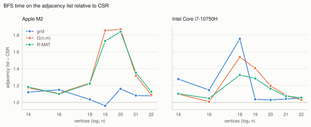

# elemgraph

Elementary graph algorithms in C++20, and experiments on what makes them fast in practice.

elemgraph is a header-only library of graph representations and elementary algorithms: BFS,
DFS, connected components, bridges and cut vertices. Each algorithm is implemented in two ways,
checked against a brute-force reference, and measured. Version 0.1 measures two questions on two
machines, an Apple M2 and an Intel x86-64 laptop:

- **Q4.** How does the chain decomposition of [Schmidt 2013] compare in practice with the classic
  lowpoint algorithm [Hopcroft & Tarjan 1973; Tarjan 1974] for bridges and cut vertices?
- **Q1.** How much does a contiguous CSR layout gain over a vector-of-vectors adjacency list for
  BFS, and how does that depend on the graph class?

elemgraph is developed by Yunze Han together with an AI coding assistant (Claude, by Anthropic).
The assistant wrote much of the code, tests and documentation. Every change was reviewed and
merged by Yunze Han.

## Results

The numbers come from two machines:
- an Apple M2 with macOS, Clang 21 and libc++;
- an Intel Core i7-10750H laptop with Linux, GCC 16 and libstdc++. There the run is pinned to one
  core at a fixed 2.6 GHz, and hardware counters are recorded.

The CPU and the compiler both differ between the two machines. Each value is the median of 10
repetitions on synthetic graphs with 2^14 to 2^22 vertices: 2D grids, uniform random graphs
G(n,m) with average degree 8, and R-MAT graphs with power-law degrees.

### Q4: chain decomposition vs. lowpoint

<picture>
  <source media="(prefers-color-scheme: dark)" srcset="bench/results/q4-dark.svg">
  
</picture>

Both algorithms start from the same DFS on the same graph and give the same output, so the left
charts compare only the work after the search.

- **Which algorithm is faster depends on the machine.** On the M2, the lowpoint algorithm is
  faster in 20 of 24 cases, by 1.2–1.9× while the graph fits in the caches. On the x86 laptop,
  the chain decomposition is faster in 10 of 24 cases:
  - by 2–6 % on grids;
  - by 3–6 % on G(n,m) with 2^18 to 2^20 vertices.

  The lowpoint algorithm is 1.1–1.35× faster there on R-MAT.
- **The hardware counters refute the first guess.** The guess was that the chain decomposition
  executes more instructions. On the x86 laptop it executes 11–13 % *fewer* than the lowpoint
  algorithm, on every graph and at every size. Where it loses clearly, on R-MAT, it mispredicts
  about 2.5 more branches per vertex: 4.3–4.8 against 1.5–2.3. In cache, that is enough for about
  half of the gap or more.
- **With the search included, the difference is small.** Including the DFS (right), the two take
  0.98–1.09× as long as each other from 2^20 vertices on, on both machines.

### Q1: CSR vs. adjacency list for BFS

<picture>
  <source media="(prefers-color-scheme: dark)" srcset="bench/results/q1-dark.svg">
  
</picture>

- **CSR is usually faster, by 1–35 %.** The one exception is the grid with 2^19 vertices on the
  M2, where the adjacency list is 4 % faster.
- **Each machine has a peak, at different sizes.**
  - On the M2, CSR is 1.7–1.9× faster on G(n,m) and R-MAT with 2^19 and 2^20 vertices.
  - On the x86 laptop, the peak lies at 2^18 vertices: 1.33–1.75× on all three classes. At 2^19,
    G(n,m) and R-MAT are still at 1.28–1.41×.
- **The cause is memory.** On the x86 laptop, both representations execute the same instructions
  with the same branch mispredictions. The adjacency list's extra time comes with extra L3 misses:
  at 2^18 vertices, 0.9–6.8 per vertex, against 0.02–1.3 for CSR.
- **A prediction failed.** On the M2, the peak lies exactly where CSR's randomly read data fits in
  the 16 MB L2 cache and the adjacency list's does not; that is 12 bytes per vertex against 32.
  The same count predicted the x86 peak at 2^19 vertices, with its 12 MB L3. It came at 2^18.
  Counting all the data that BFS reads fits the x86 laptop, but not the M2.

The full tables, the counters, the variation between repetitions and runs, and more observations
are in [`bench/results/m2/2026-11-11.md`](bench/results/m2/2026-11-11.md) and
[`bench/results/x86-laptop/2026-11-11.md`](bench/results/x86-laptop/2026-11-11.md).

### Not explained yet

- Why the Q1 peak lies at 2^19–2^20 vertices on the M2 but at 2^18 on the x86 laptop. No single
  count of bytes per vertex explains both.
- On the x86 laptop, BFS on the grid becomes 5× slower per vertex from 2^19 vertices on, and DFS
  on the same grid does not. A guess is TLB misses: on the grid, the BFS frontier is a diagonal,
  and from 2^19 vertices on, each of its vertices lies on a different 4 KB page.
- Which branches the chain decomposition mispredicts on R-MAT. Also, how much of the Q4
  difference between the machines comes from the compiler rather than the CPU.
- The DFS executes 3–3.5× as many instructions per vertex as BFS. On G(n,m) and R-MAT it takes
  1.8–3.5× as long.
- On the M2, BFS on the grid with 2^19 vertices is faster on the adjacency list than on CSR.

## What is in v0.1

| Part | Implementations | File |
|------|-----------------|------|
| Representations | `csr_graph` (built by counting sort), `adjacency_list` (vector of vectors), both from an `edge_list` | [`include/elemgraph/`](include/elemgraph/) |
| BFS | flat-array queue vs. `std::queue` | [`algorithms/bfs.hpp`](include/elemgraph/algorithms/bfs.hpp) |
| DFS | iterative, explicit stack; preorder, DFS numbers, parents | [`algorithms/dfs.hpp`](include/elemgraph/algorithms/dfs.hpp) |
| Connected components | BFS vs. union-find | [`algorithms/components.hpp`](include/elemgraph/algorithms/components.hpp) |
| Bridges, cut vertices | lowpoint vs. chain decomposition (which can also return the chains) | [`algorithms/connectivity.hpp`](include/elemgraph/algorithms/connectivity.hpp) |

The algorithms are templates over the concepts in
[`concepts.hpp`](include/elemgraph/concepts.hpp), so the same code runs on both representations.
Graphs may have parallel edges, several components and vertices of any degree; self-loops are
dropped. The chain decomposition was proved for simple connected graphs.
[`docs/chain-decomposition.md`](docs/chain-decomposition.md) proves the rules that elemgraph
uses for this general case.

**Correctness.**
- Every algorithm is compared with a brute-force reference that applies the definitions directly,
  on thousands of random multigraphs with parallel edges, self-loops and several components.
- The two implementations of each problem are compared with each other.
- CI builds and tests with GCC and Clang, with AddressSanitizer and UndefinedBehaviorSanitizer
  on Linux, and with Clang on macOS. It also runs every benchmark once on tiny graphs.

## Using it

```cpp
#include <elemgraph/algorithms/connectivity.hpp>
#include <elemgraph/csr_graph.hpp>
#include <iostream>

int main() {
    // Two triangles that share vertex 2, and an edge hanging off vertex 4.
    elemgraph::edge_list list(6);
    list.add_edge(0, 1);
    list.add_edge(1, 2);
    list.add_edge(2, 0);
    list.add_edge(2, 3);
    list.add_edge(3, 4);
    list.add_edge(4, 2);
    list.add_edge(4, 5);
    const elemgraph::csr_graph g(list);

    const elemgraph::connectivity_result result = elemgraph::chain_connectivity(g);
    for (const elemgraph::edge_id e : result.bridges) {
        std::cout << "bridge " << list.edges()[e] << '\n';  // bridge 4-5
    }
    for (const elemgraph::vertex v : result.cut_vertices) {
        std::cout << "cut vertex " << v << '\n';  // cut vertex 2, cut vertex 4
    }
}
```

The library needs only a C++20 compiler. You can add `include/` to the include path, or add the
repository to a CMake project with `add_subdirectory(elemgraph)` and link to `elemgraph::elemgraph`.

## Building, testing and benchmarking

Everything runs in a Nix dev shell, which provides the compilers, CMake, GoogleTest and Google
Benchmark in fixed versions:

```sh
nix develop                      # enter the dev shell
cmake --workflow --preset dev    # build and run the tests (also: release, sanitize)
nix flake check                  # what CI runs: GCC, Clang and sanitizer builds on Linux
bench/run.sh m2                  # all benchmarks, into bench/results/m2/<date>.json
nix develop .#plot -c python3 bench/plot.py bench/results/m2/<date>.json --tables
nix develop .#plot -c python3 bench/plot.py --out bench/results \
    bench/results/m2/<date>.json bench/results/x86-laptop/<date>.json   # the figures above
```

Without Nix, you need CMake 3.25 or newer, a C++20 compiler, GoogleTest and Google Benchmark.

`bench/run.sh` records the commit and the machine's settings in the results. On Linux it also
pins the run to one core, checks the CPU governor and turbo, and collects hardware counters per
benchmark. A full run takes about 25 minutes on the M2.

**Platform limits.** macOS can neither pin a thread to a core nor fix the clock. The benchmarks
run at the highest QoS class, which keeps them on the performance cores. Variation is reported
with every result. CI runs on virtual machines, so its timings are never reported.

## Plans

| Version | Topic |
|---------|-------|
| v0.2 | Certifying 2-connectivity: certificates and a linear-time checker, and what certification costs (Q6). Vertex and edge index types as template parameters, and whether 32 or 64 bits matter (Q2). Memory layout (Q3). The open points above: TLB counters, a Clang build on Linux, a profile of the chain decomposition, a faster DFS. |
| v0.3 | Certifying 3-edge-connectivity [Mehlhorn, Neumann, Schmidt 2017], built on the chain decomposition |
| later | Vertex reordering (Q5), weighted graphs and Dijkstra, parallel BFS and components |

The design, the research questions and the benchmark method are described in
[`docs/DESIGN.md`](docs/DESIGN.md). Changes are listed in [`CHANGELOG.md`](CHANGELOG.md).

## References

- J. M. Schmidt. *A simple test on 2-vertex- and 2-edge-connectivity.* Information Processing
  Letters 113(7):241–244, 2013.
- J. Hopcroft, R. Tarjan. *Algorithm 447: Efficient algorithms for graph manipulation.*
  Communications of the ACM 16(6), 1973.
- R. E. Tarjan. *A note on finding the bridges of a graph.* Information Processing Letters 2(6),
  1974.
- K. Mehlhorn, A. Neumann, J. M. Schmidt. *Certifying 3-edge-connectivity.* Algorithmica
  77:309–335, 2017.

## License

MIT. See [`LICENSE`](LICENSE).
